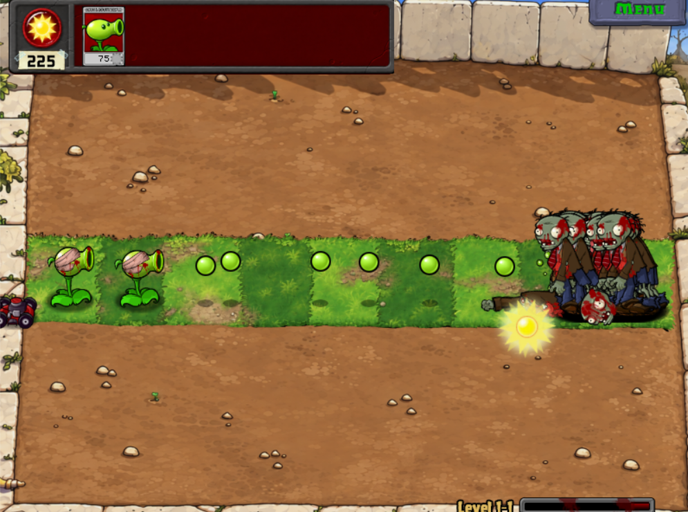
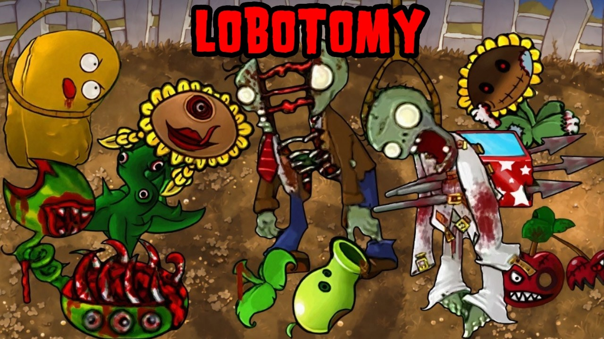

# Plants vs. Zombies Lobotomy Recreated V2

**Plants vs. Zombies Lobotomy Recreated V2** é um mod visual de *Plants vs. Zombies 1*. Ele mantém a base do jogo original e troca principalmente as texturas das plantas e dos zumbis por versões sombrias e grotescas, inspiradas no projeto chinês *Plants vs. Lobotomy*.

## O que muda no mod

- Plantas e zumbis recebem uma aparência de horror, com desenhos deformados e detalhes macabros.
- A V2 parte do **Lobotomy Recreated v0.1** e traz melhorias visuais sobre essa recriação.
- A experiência continua sendo, em essência, a de PvZ 1 com outra identidade visual.

## Origem e versões

| Versão | Quem fez | Relação com a V2 |
| --- | --- | --- |
| **Plants vs. Lobotomy original** | Criado na China pelo usuário **「奇怪的酷哥」**, do Bilibili. | Serviu de inspiração visual. |
| **Lobotomy Recreated v0.1** | Recriação feita por outro fã; o nome do criador não está confirmado aqui. | Foi a base usada para a V2. |
| **Lobotomy Recreated V2** | Atualização feita por um usuário a partir da v0.1; o nome desse usuário também não está confirmado aqui. | É a versão apresentada neste README. |

O mod chinês original, a recriação v0.1 e a atualização V2 são etapas de desenvolvimento diferentes. Os créditos de uma não devem ser atribuídos automaticamente às outras.

## Vídeo e download

- [Página da V2 no Game Jolt](https://gamejolt.com/games/Dowload_PvzLobotomy/1104985)

Este repositório contém o README e as imagens acima. O jogo pode ser encontrado na página externa indicada.

## Referências

- [Perfil no Bilibili associado ao criador do Lobotomy original](https://space.bilibili.com/160265921)
- [História do mod original no DTF](https://dtf.ru/id1146790/3169032-plants-vs-lobotomy-chto-za-mod-i-gde-ego-skachat)
- [Página sobre o Lobotomy Recreated v0.1](https://squanchcommunity.com/plants-vs-zombies-lobotomy-recreated-v0-1-beta-creepypasta-horror-genocide-mod/)
- [Página sobre o Lobotomy Recreated V2](https://squanchcommunity.com/plants-vs-zombies-lobotomy-recreated-v2-ultimate-gore-insane-arsenal-upgrade/)
